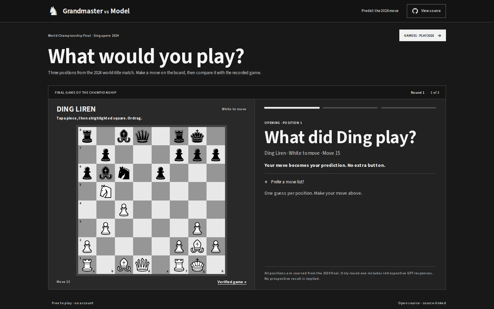

# Grandmaster vs Model

**Could you match a world champion? Three real positions, three decisions, one score.**

Play a free three-move chess challenge built from the real 2024 World Championship final. Choose the move, reveal the grandmaster’s decision, and share your score. Behind the public challenge is an open, independently maintained prospective model-forecasting experiment. We compare *actual next moves* with verifiable model forecasts. The 2026 Gukesh–Sindarov match starts **24 November 2026** in Geneva, according to [FIDE's championship calendar](https://worldchampionship.fide.com/schedule).

[Play the three-move challenge](https://fraware.github.io/grandmaster-vs-model/#challenge) · [Follow the 2026 match](https://fraware.github.io/grandmaster-vs-model/lab.html?mode=live#experiment) · [Read the methodology](METHOD.md) · [Review the launch plan](LAUNCH.md)

[](https://github.com/fraware/grandmaster-vs-model/actions/workflows/ci.yml) [](https://github.com/fraware/grandmaster-vs-model/actions/workflows/pages.yml)



*Actual Chromium capture of the new editorial-style historical challenge. Its retrospective GPT comparison is distinct from the upcoming 2026 model experiment.*

## Play in under a minute

1. Tap a piece and its destination, or drag the piece on touchscreens and desktop. The board previews your choice before you commit. A collapsible legal-move list provides a keyboard-friendly alternative.
2. Reveal the actual move with a short board animation. Repeat for three positions from the 2024 final. Arrow keys navigate the chessboard, with Enter or Space selecting a square. Reduced-motion preferences are respected.
3. Share the three-square result with a friend. On supported mobile browsers, the share sheet includes a generated score image; the text-copy and PNG-download fallbacks work without an account.

The primary homepage contains one chessboard. The full historical and live research interface is available separately at `lab.html`. The question set is deterministic and legally replayed from the bundled historical PGN, using `src/challenge.mjs` and `src/challenge-ui.mjs`. The visitor score is held only in the current browser session. An optional recorded GPT comparison appears strictly after the visitor locks each move. Since the 2024 game was already public prior to the 2026 model release, any such response is a **retrospective demonstration**, not an unbiased forecasting benchmark, Elo rating, or global ranking. Sharing never triggers provider inference. No user scores are collected by this project.

## Historical model demonstration

To make the primary challenge an actual human-versus-model experience, a one-time integration workflow calls the confirmed working OpenAI model on precisely the three sourced 2024 positions. Its prompt uses the 2024 event, the exact board FEN, previous moves, and legal candidates, never the subsequent moves. There are **at most three provider requests** in the initial run. Every attempt is included, even errors and invalid output. The workflow does not make a 2026 claim or auto-publish its raw results.

- [`scripts/retrospective-run.mjs`](scripts/retrospective-run.mjs) contains the bounded collector with a test-injectable provider adapter. Its `historical-api-evidence` artifact was retrieved from the actual authenticated run and verified before publication.
- [`src/retrospective.mjs`](src/retrospective.mjs) validates exact source identity, legal moves, API outputs, payload hashes, and failure statuses. The public index lives at [`data/retrospective-2024.json`](data/retrospective-2024.json). The published file now contains the three authenticated API responses, including their exact prompts, outputs, timestamps, usage, provider response identifiers and SHA-256 checksums.
- The homepage reveals a recorded model move **only after** the user locks their own move. A three-round human-versus-model comparison appears only if all three model responses are legal. The source records link directly to GitHub. If evidence is missing or malformed, the sourced human challenge remains available without an AI score.
- Replaying a game known before the model release is vulnerable to memorization and benchmark contamination. This feature is entertainment with inspectable provenance, not proof that a frontier model predicted a future human decision. The prospective 2026 experiment is separate.

Run `npm run verify:retrospective` to check the published model evidence. GitHub's `Verify historical GPT comparison` workflow triggers once upon first installation and does not reissue paid requests for subsequent source changes. Manual dispatch repeats the calls and incurs additional charges.

**Actual initial result, 19 November 2026:** The [GitHub integration run](https://github.com/fraware/grandmaster-vs-model/actions/runs/44514351159) returned three valid legal UCI moves from `gpt-6.2-astra`, and all three matched the recorded 2024 grandmaster decisions (3/3). This is a **retrospective demonstration on a known game**. It does not establish predictive ability, out-of-sample performance, or an independent provider attestation; the model might have memorized the public game. The record contains 1,646 billed input tokens and 74 billed output tokens in total, as reported by the API. The current public UI never consumes model API credits per visitor.

## What already works

- **Real historical challenge.** The 2024 World Championship final (Ding–Gukesh, Game 14, 12 December) is supplied as 116 *legally verified* half-moves, reconstructed from its [Lichess broadcast](https://lichess.org/broadcast/fide-world-championship-2024/game-14/LtsCRK9D/YaARFAYu). The homepage challenge provides three curated positions, an exact-match score, and a shareable result. The separate [research lab](https://fraware.github.io/grandmaster-vs-model/lab.html) supports inspecting all recorded positions, replaying moves, comparing public model attempts and sharing position links.
- **Real 2026 broadcast input.** Game 1 has a [public Lichess broadcast](https://lichess.org/broadcast/fide-world-chess-championship-2026/game-1/xLgOJ6cb). The site requests its PGN through Lichess's public API, reconstructs legal chess positions, and checks for updates at most every three minutes while the live tab is active. A legally checked same-origin snapshot is also generated during Pages deployments; visitors still have a recent cached position if their direct request fails. Neither retrieval time establishes the physical playing time. Later match games need their own confirmed broadcast IDs.
- **Inspectable prediction ledger.** The repository contains a validated source-reception ledger, digest-protected provider-attempt records, duplicate rejection, chess-legality checks, a shared prompt, and optional REST adapters for OpenAI, Anthropic, and Gemini (tested offline only).
- **Local-first site.** No external fonts, trackers, cookies, ads, mandatory account, or third-party JavaScript. The browser requests public game PGN directly from Lichess; no credential leaves the browser.

**Evidence status as of 19 November 2026:** The 2026 championship has not begun. The repository has **zero prospective 2026 model forecasts** and **zero observed 2026 moves**. The separate historical model demonstration has three real API responses. Authenticated provider checks and the 2024 retrospective demonstration are separate from the championship ledger; no 2026 match forecasts or Stockfish evaluation have been run. There is no prospective leaderboard. The browser-side Lichess endpoint has been tested with offline fixtures, including cache fallback; actual cross-origin behavior still needs an end-to-end deployed-network check. Desktop and mobile Chromium interaction tests passed with isolated network fixtures, including real touch events, mouse dragging, keyboard navigation, and share/export paths.

## Why this project is different

Prior systems already predict human chess moves. Relevant work includes [ChessDS DSC](https://github.com/ChessDS/chessds-dsc), [Maia-3](https://github.com/CSSLab/maia3), [MoveLens](https://chessassistlens.vercel.app/research), [ChessBench](https://chessbench.org/), and [LLMChessArena](https://github.com/DeadPackets/LLMChessArena). Historical replay and move-guessing games also predate this project. The intended contribution is **event-specific, prospective model forecasting with public pre-move records and reproducible scoring**, not an assertion that chess prediction itself was invented here.

An accurate prediction of a human's actual choice is different from choosing a move favored by a chess engine. These outcomes must be evaluated separately.

## Quick start

Node.js 20+ is needed for tests, record management, and model adapters; Python 3 is optional for the local site.

```sh
npm test
npm run verify
npm run build:data
npm run verify:retrospective
npm run verify:collection
python3 -m http.server 8080
```

Open `http://localhost:8080/`. The homepage challenge works from bundled game data with no live network dependency. Open `http://localhost:8080/lab.html?mode=live` for the championship broadcast, which attempts a direct Lichess request. Browser networking or CORS policy might block that request; an optional validated cached broadcast is used as a fallback. The fallback timestamp is explicitly labelled as a fetch time, not a move time. Direct `file://` navigation does not reliably permit JSON loading.

## Public broadcast cache

The Pages workflow attempts to fetch the official Game 1 PGN during deployment and writes a legally checked same-origin cache into the **published artifact only**. It does not modify tracked source files or represent a forecast. A failed fetch preserves the packaged default, without inventing moves. The direct browser request supplies fresher observations while the live tab is open; it is limited to one initial request plus a three-minute interval (five minutes if an error occurs). The homepage challenge never polls Lichess. The research lab checks the live feed only while its live view is active.

An operator may regenerate a cache locally using `node scripts/cache-broadcast.mjs --out /path/to/live-game1.json`. The committed default under `data/live-game1.json` is intentionally empty prior to 24 November 2026. The site rejects illegal cached moves, mismatched players, and changed live history within a browsing session. The build cache is a best-effort availability mechanism, **not immutable source evidence, publication priority, or a record of physical move times**. The capture workflow is scheduled at five-minute intervals within selected UTC hours on championship dates. An actual new observation or model attempt triggers a data commit, which triggers a Pages build and refreshes the cached broadcast. GitHub Actions schedules are best effort; delays and missed positions are expected. The browser direct feed remains available without automated collection. While the live tab is active, the website also refreshes the same-origin public attempt index at most once every two minutes, without requiring a reload.

## Frontier-model field and prospective capture

The public model roster in [`data/models.json`](data/models.json) contains official API identifiers checked **19 November 2026**. Listing a model does not imply API access or a measured result.

| Provider | Model | Source |
| --- | --- | --- |
| OpenAI | `gpt-6.2-astra` | [OpenAI model specification](https://developers.openai.com/api/docs/models/gpt-6.2-astra) |
| Anthropic | `claude-fable-5-2` | [Claude model catalog](https://platform.claude.com/docs/en/models/overview) |
| Google | `gemini-4-neon` | [Gemini model catalog](https://aistudio.google.com/docs/models) |

The [`Capture prospective forecasts`](.github/workflows/capture.yml) action polls the [identified Game 1 broadcast](https://lichess.org/broadcast/fide-world-chess-championship-2026/game-1/xLgOJ6cb). If a legal 2026 game position and registered provider credentials exist, it sends a documented shared prompt to each configured API once per position. The source is restricted to the standard initial chess position, and broadcast player names are mapped to canonical identities before being placed in prompts. The public artifacts are:

- `data/observations/game1.json` — first *feed reception* times for legally reconstructed moves; never claimed as physical move times.
- `data/attempts/*.json` — full prompt, raw model output or explicit failure, provider-reported model/response ID if available, digests, and local request timestamps. A second broadcast fetch detects obvious position changes during collection.
- `data/collection.json` — minimized, reproducibly derived index rendered on the website. Valid attempts are **provisional** and excluded from a ranked score until independently inspectable publication priority is established.

The workflow is active only for the defined **24 November–12 December 2026** collection interval. The five-minute cron cadence is not guaranteed by GitHub and might miss short time intervals. It is not a continuous, latency-bounded service. Only Game 1 has a confirmed broadcast round ID. To cover more games, obtain and verify their round identifiers and extend the implementation explicitly.

### Checking provider access before Game 1

The [Verify frontier model access](.github/workflows/provider-smoke.yml) workflow runs **once on initial installation** and is available for later manual execution. It invokes each configured API model at most once using a small synthetic opening-position prompt. The command reports which keys were available to the job, the returned provider model identifier, and whether the response contained one legal UCI move. A seven-day GitHub Actions artifact retains a sanitized health report. The check does **not** create a championship prediction or contribute to the match leaderboard.

The command is intentionally unsuccessful if every credential is missing or if any configured provider fails. Missing individual keys are recorded without affecting the status of other providers. Anthropic keys created without a fixed workspace may need an additional `ANTHROPIC_WORKSPACE_ID` repository secret containing the workspace identifier from the Claude Console. If Google returns HTTP 403, inspect the sanitized status and your Gemini API project access before changing the public model roster. Do not copy API keys into issues, local screenshots, logs, or this repository. A successful check confirms only access at that moment, not access on match day. Manual reruns incur additional API charges.

[Open the credential verification workflow](https://github.com/fraware/grandmaster-vs-model/actions/workflows/provider-smoke.yml)

**To enable actual API predictions**, add the corresponding credentials at [Settings → Secrets and variables → Actions](https://github.com/fraware/grandmaster-vs-model/settings/secrets/actions), using the exact names `OPENAI_API_KEY`, `ANTHROPIC_API_KEY`, and `GEMINI_API_KEY`. For an Anthropic key that is not tied to one workspace, also add `ANTHROPIC_WORKSPACE_ID` with its workspace identifier. This value is sent as a request header exclusively to Anthropic. Add only the providers you intend to fund. The workflow ignores providers without a key. Provider calls incur usage charges. Secrets are never written to the site, files, or workflow logs. Authenticated provider access is assessed by the separate credential verification workflow. Inspect its actual report before claiming successful inference; access, model support, rate limits, and individual spending limits must be confirmed.

You can trigger one collector run manually from [Actions → Capture prospective forecasts](https://github.com/fraware/grandmaster-vs-model/actions/workflows/capture.yml). Prior to the opening game, the collector records no forecasts. A finished match stops calls. Automated data commits use the transparent GitHub Actions bot identity, distinct from the owner's code commits.

```sh
npm test
npm run verify:collection
npm run capture:once    # needs a real match position and provider secrets to invoke models
```

The earlier [`scripts/model-runner.mjs`](scripts/model-runner.mjs) is also available for deliberate single-model invocations. Its output is operator-originated; it does not gain priority or provider attestation from a self-reported timestamp.

**Methodological boundary:** A local SHA-256 digest is not a timestamp. `firstObservedAt` is a source reception time, not the physical move time. Git hosting establishes public version history, subject to delivery delays. API requests, commits, and the championship broadcast are separate clocks. We will not publish a cross-model accuracy leaderboard without checking their relationship. See [METHOD.md](METHOD.md).

## Files

| Path | Role |
| --- | --- |
| `index.html`, `landing.css`, `src/home.mjs` | Single-purpose challenge entrance with no model calls |
| `lab.html`, `style.css`, `app.mjs` | Full historical/live research explorer and model evidence UI |
| `src/challenge.mjs`, `src/challenge-ui.mjs` | Sourced three-position challenge, local scoring and share images |
| `src/chess.mjs` | Dependency-free standard chess rules, SAN/UCI and FEN |
| `src/challenge.mjs`, `src/challenge-ui.mjs` | Sourced three-position human challenge, score, and share image |
| `assets/share-cover.png` | Social-preview image used by Open Graph and X cards |
| `src/pgn.mjs`, `src/broadcast.mjs` | Strict PGN parser, source checks and validated cache |
| `data/archive-2024.json` | Historically sourced full game for local challenge |
| `data/retrospective-2024.json` | Three authenticated, post-event model attempts with full prompts and responses |
| `scripts/retrospective-run.mjs`, `src/retrospective.mjs` | Three-call bounded model demonstration and evidence verifier |
| `data/match.json` | Generated 2026 forecast and observed-move ledger |
| `data/live-game1.json` | Empty pre-match baseline for public broadcast caching |
| `data/models.json` | Versioned provider model roster with primary documentation |
| `data/collection.json` | Derived index of source observations and recorded model calls |
| `scripts/forecast-cycle.mjs`, `scripts/collection.mjs` | Optional, audited prospective capture and index validation |
| `src/collection.mjs` | Source/attempt validation and reproducible public projection |
| `scripts/ledger.mjs` | Record, verify, rebuild ledger data |
| `scripts/model-runner.mjs` | Optional real model API adapters |
| `scripts/cache-broadcast.mjs` | Best-effort static source snapshot generation |
| `tests/` | Chess perft, protocols, provider mocks, PGN validation and an optional Chromium UI smoke test |
| `.github/workflows/` | CI and GitHub Pages deployment |

## Optional browser integration test

The repository includes a reproducible Chromium smoke test at 320px, mobile, and desktop widths on the separate homepage and lab routes. It uses a clearly artificial six-ply PGN fixture to exercise the live view without presenting those moves as observed championship data. The browser test additionally completes the three-position challenge, checks touch-based selection, mouse dragging, retained chessboard focus, keyboard navigation, exact-match scoring, share text, native-fallback behavior and PNG export, and exercises source-replay and outage handling in the lab. This is distinct from testing the actual deployed origin or Lichess cross-origin policy.

```sh
python -m pip install playwright
python -m playwright install chromium
python tests/browser-smoke.py
```

Use `CHROMIUM_PATH=/path/to/chromium` for a system browser and `GVM_SCREENSHOT_DIR=/your/directory` for screenshots. These optional dependencies are unnecessary to run the website.

## Hosting

GitHub Pages uses `Settings → Pages → Build and deployment → GitHub Actions`. The publishing workflow builds the site and validates data on each push. Inspect [the current deployment workflow](https://github.com/fraware/grandmaster-vs-model/actions/workflows/pages.yml) to confirm the live environment rather than inferring deployment from passing CI. The first attempted deployment returned 404 with Pages disabled; rerunning that same failed job subsequently caused a duplicate-artifact error. A new push starts a fresh workflow run.

Source code and original design are licensed under MIT. World Championship scores and event details are sourced to Lichess/FIDE. This is an independent project with no affiliation or endorsement by FIDE, Lichess, players, or model providers.
