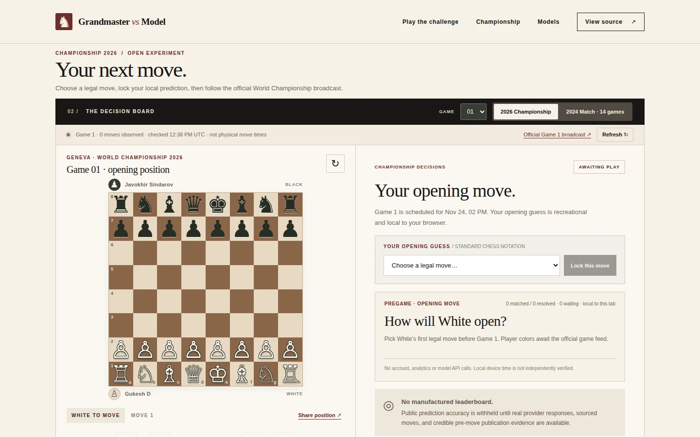

# Grandmaster vs Model

**Could you match a world champion? Fifteen sourced positions, five rounds, and a first-round comparison with recorded GPT responses.**

Play a free chess challenge built from the real 2024 World Championship final. Make a legal move directly on the board to reveal the recorded grandmaster decision, compare your first three moves with a retrospective GPT API run, and continue through four further three-position practice sets. Share a score from any completed set. Behind the public challenge is an open, independently maintained prospective model-forecasting experiment. We compare *actual next moves* with verifiable model forecasts. The 2026 Gukesh–Sindarov match starts **24 November 2026** in Geneva, according to [FIDE's championship calendar](https://worldchampionship.fide.com/schedule).

[Play the 2026 next-move challenge](https://fraware.github.io/grandmaster-vs-model/lab.html?mode=live&game=1#experiment) · [Play the 2024 challenge](https://fraware.github.io/grandmaster-vs-model/#challenge) · [Read the methodology](METHOD.md) · [Review the launch plan](LAUNCH.md)

[](https://github.com/fraware/grandmaster-vs-model/actions/workflows/ci.yml) [](https://github.com/fraware/grandmaster-vs-model/actions/workflows/pages.yml)


*Actual Chromium capture of the new editorial-style historical challenge. Its retrospective GPT comparison is distinct from the upcoming 2026 model experiment.*

## Play the 2026 championship as it unfolds

**The next move is yours.** Before Game 1, open the [2026 board](https://fraware.github.io/grandmaster-vs-model/lab.html?mode=live&game=1#experiment) and make a legal opening guess for White. The choice locks as soon as you play it on the board. Once the official, source-validated Lichess PGN adds the move, your choice is revealed as an exact match or an alternative. Continue to the latest position to make the next decision. During an active 2026 game, the current legally reconstructed position supports the same interaction; older positions are read-only.

**One visible action.** Tap a piece and its destination, drag a piece, or use the legal-move selector and Lock button. The board supports arrow-key navigation and Enter. Mobile touch and reduced-motion users are supported. Share your local guess or match result without signing in.

**Private by design.** Each choice is kept in the browser's per-tab `sessionStorage`, falling back to volatile in-memory state if storage is blocked. No visitor-specific data, public leaderboard submission, provider credential, tracking identifier or model inference is sent from the participation flow. Its local timestamp is **not independently authenticated**. The result is recreational and never enters the scientific model-forecast ledger. A failed source refresh preserves the locked choice, and inconsistent broadcast history is rejected rather than silently rewriting it.

**Source limitations.** A submitted opening guess before the game is not an authenticated claim of prospectivity. During play, a supported next-move position exists only in the official game session and with a successfully retrieved, legally validated open broadcast. The public source can arrive later than physical play. No local prediction is certified as preceding the player's physical move. The audience-facing 2026 experience is independent of the paid, reserved model requests.

The implementation is in [`src/spectator.mjs`](src/spectator.mjs) and the main [live chess interface](app.mjs). Reproduce the isolated unit tests with `npm test` and the full spectator browser sequence with `python tests/live-spectator-smoke.py` after installing the pinned Playwright/Chromium environment described in [CI](.github/workflows/ci.yml).



*Pregame interface rendered in Chromium with a deterministic fixture, not a recording of played 2026 championship moves. [Mobile screenshot](assets/live-preview-mobile.webp).*

## The championship is one action from the homepage

A compact 2026 World Championship action appears in the **first-screen homepage heading** on desktop and mobile, retaining the original 2024 chessboard's first-viewport placement. A fuller event invitation follows the historical challenge. Both links select the next relevant round using the pinned 14-round UTC registry. Ahead of the announced start it invites a local opening prediction, during the scheduled session it opens the latest sourced position, and beyond the listed rounds it provides a replay entry. The schedule does not establish that physical play has started. Route selection is deterministic and tested in [`src/home-entry.mjs`](src/home-entry.mjs) and [`tests/home-entry.test.mjs`](tests/home-entry.test.mjs).

## Complete 2024 championship game records

The historical reader now includes **all 14 games and all 1,270 recorded half-moves**, including SAN, UCI, and the legal board position before and after each move. Each game is source-linked to its Lichess broadcast and cross-checked against the separately published PGN Mentor match record. The full source-by-source verification, move counts, checksums, licensing, and limitations are in [DATA_AUDIT.md](DATA_AUDIT.md).

Open [the full match replay](https://fraware.github.io/grandmaster-vs-model/lab.html?mode=archive&game=1#experiment) and select any game. Historical games are distinct from the unplayed 2026 championship.

## Play without a tutorial

1. Tap or drag a legal piece to its destination. The selected piece moves on the board; the choice locks automatically and the recorded grandmaster move is revealed. No separate Reveal confirmation is needed. The alternative move list remains accessible for keyboard and assistive-technology users.
2. Continue to the next position using the prominent Next action, including a persistent mobile action after each reveal. The main challenge has three positions and is scored on exact moves, independently of chess strength.
3. Compare your result with the three genuine, retrospectively collected GPT API responses; share a score and image, or continue into **four additional three-position sets** from the legally replayed 2024 final. The additional positions have **no GPT attempts**, and the interface does not invent corresponding model scores.

The challenge runs without an account, cookies, visitors' API keys, or visitor-specific inference. No scores are sent to a server. Browser tests exercise drag, tap, keyboard focus, automatic commitment, an additional full set, native sharing, and PNG fallback exports. The GitHub CI workflow now installs a pinned Chromium test runtime and executes the browser suite in addition to the Node unit tests. Run `CHROMIUM_PATH=/usr/bin/chromium python tests/browser-smoke.py` to reproduce the default smoke checks, or set `GVM_EXTENDED_BROWSER=1` to exercise all fifteen positions and a fresh-run reset. Reduced-motion preferences are honored, and the site keeps one 64-square board rather than rebuilding it on each selection.

## Historical model demonstration

To make the primary challenge an actual human-versus-model experience, a one-time integration workflow calls the confirmed working OpenAI model on precisely the three sourced 2024 positions. Its prompt uses the 2024 event, the exact board FEN, previous moves, and legal candidates, never the subsequent moves. There are **at most three provider requests** in the initial run. Every attempt is included, even errors and invalid output. The workflow does not make a 2026 claim or auto-publish its raw results.

- [`scripts/retrospective-run.mjs`](scripts/retrospective-run.mjs) contains the bounded collector with a test-injectable provider adapter. Its `historical-api-evidence` artifact was retrieved from the actual authenticated run and verified before publication.
- [`src/retrospective.mjs`](src/retrospective.mjs) validates exact source identity, legal moves, API outputs, payload hashes, and failure statuses. The public index lives at [`data/retrospective-2024.json`](data/retrospective-2024.json). The published file now contains the three authenticated API responses, including their exact prompts, outputs, timestamps, usage, provider response identifiers and SHA-256 checksums.
- The homepage reveals a recorded model move **only after** the user locks their own move. A three-round human-versus-model comparison appears only if all three model responses are legal. The source records link directly to GitHub. If evidence is missing or malformed, the sourced human challenge remains available without an AI score.
- Replaying a game known before the model release is vulnerable to memorization and benchmark contamination. This feature is entertainment with inspectable provenance, not proof that a frontier model predicted a future human decision. The prospective 2026 experiment is separate.

Run `npm run verify:retrospective` to check the published model evidence. GitHub's `Verify historical GPT comparison` workflow triggers once upon first installation and does not reissue paid requests for subsequent source changes. Manual dispatch repeats the calls and incurs additional charges.

**Actual initial result, 19 November 2026:** The [GitHub integration run](https://github.com/fraware/grandmaster-vs-model/actions/runs/44514351159) returned three valid legal UCI moves from `gpt-6.2-astra`, and all three matched the recorded 2024 grandmaster decisions (3/3). This is a **retrospective demonstration on a known game**. It does not establish predictive ability, out-of-sample performance, or an independent provider attestation; the model might have memorized the public game. The record contains 1,646 billed input tokens and 74 billed output tokens in total, as reported by the API. The current public UI never consumes model API credits per visitor.

## What already works

- **Real historical challenge.** The 2024 World Championship final (Ding–Gukesh, Game 14, 12 December) is supplied as 116 *legally verified* half-moves, reconstructed from its [Lichess broadcast](https://lichess.org/broadcast/fide-world-championship-2024/game-14/LtsCRK9D/YaARFAYu). The homepage challenge provides three curated positions, an exact-match score, and a shareable result. The separate [research lab](https://fraware.github.io/grandmaster-vs-model/lab.html?mode=archive&game=1#experiment) lets visitors select any of the 14 championship games, replay every recorded move, examine the validated positions and share game-specific links. The separate 2026 experiment displays only genuinely observed moves and recorded model attempts.
- **Verified 2026 match-wide broadcast sources.** All 14 Lichess round IDs, actual source URLs, and scheduled starting times were retrieved from the [tournament metadata API](https://lichess.org/api/broadcast/qfkdt8mn) on 20 November 2026, pinned in [`data/broadcast-2026.json`](data/broadcast-2026.json), and validated on every CI run. The research page can select any game and request its distinct PGN. Per-game repository observation records provide a fallback for games that have already begun. Broadcast retrieval and local clocks do not prove the physical time at which a player moved.
- **Inspectable prediction ledger.** The repository contains a validated source-reception ledger, digest-protected provider-attempt records, duplicate rejection, chess-legality checks, a shared prompt, and optional REST adapters for OpenAI, Anthropic, and Gemini. OpenAI passed an authenticated test in November 2026; Anthropic and Gemini returned provider access errors. Adapter behavior is also tested with offline fixtures.
- **Local-first site.** No external fonts, trackers, cookies, ads, mandatory account, or third-party JavaScript. The browser requests public game PGN directly from Lichess; no credential leaves the browser.

**Evidence status as of 20 November 2026:** The 2026 championship has not begun. The repository has **zero prospective 2026 model forecasts** and **zero observed 2026 moves**. The separate historical model demonstration has three real API responses. Authenticated provider checks and the 2024 retrospective demonstration are separate from the championship ledger; no 2026 match forecasts or Stockfish evaluation have been run. There is no prospective leaderboard. The 2026 collector is limited to a predeclared five-ply sample (rotated by game number), at most 900 request reservations or pre-reservation attempts across the 14 scheduled rounds; unresolved reservations consume capacity. The cap controls call count, not dollar spending; configure separate limits with each API provider. Unobserved and unsampled positions are never reported as successful predictions. The browser-side Lichess endpoint has been tested with offline fixtures, including cache fallback; actual cross-origin behavior still needs an end-to-end deployed-network check. Desktop and mobile Chromium interaction tests passed with isolated network fixtures, including real touch events, mouse dragging, keyboard navigation, and share/export paths.

## Deployed live-source preflight (20 November 2026)

A credential-free [GitHub Actions production preflight](.github/workflows/production-preflight.yml) now opens the **actual deployed GitHub Pages** chess interface in Chromium and confirms that the page's own current cross-origin Lichess fetch completes. It also checks all 14 round options, the 64-square board, spectator controls, JavaScript exceptions, and mobile horizontal overflow. A separate browser-origin PGN fetch records the public HTTP status, response content type, byte count, and request duration without retaining PGN contents. Screenshots and a JSON diagnostic report are uploaded as short-retention workflow artifacts.

The [20 November browser run](https://github.com/fraware/grandmaster-vs-model/actions/runs/44742780417) passed. The official Game 1 PGN returned HTTP 200, and the deployed site independently displayed **zero observed moves** with a newly completed source check. This is a single measured production check, not a commitment about network availability or latency during live gameplay. The probe uses no model provider credentials, makes no paid requests, and does not authenticate physical move timing.

To recheck the deployed site without changing its data, manually dispatch **Production spectator and Lichess browser preflight** from GitHub Actions. For local reproduction after installing Playwright 1.57 and its Chromium browser, run `python tests/production-preflight.py`. The command connects to the live deployed Pages URL and Lichess, so it intentionally differs from our offline browser fixtures.

## Why this project is different

Prior systems already predict human chess moves. Relevant work includes [ChessDS DSC](https://github.com/ChessDS/chessds-dsc), [Maia-3](https://github.com/CSSLab/maia3), [MoveLens](https://chessassistlens.vercel.app/research), [ChessBench](https://chessbench.org/), and [LLMChessArena](https://github.com/DeadPackets/LLMChessArena). Historical replay and move-guessing games also predate this project. The intended contribution is **event-specific, prospective model forecasting with public pre-move records and reproducible scoring**, not an assertion that chess prediction itself was invented here.

An accurate prediction of a human's actual choice is different from choosing a move favored by a chess engine. These outcomes must be evaluated separately.

## Quick start

Node.js 20+ is needed for tests, record management, and model adapters; Python 3 is optional for the local site.

```sh
npm test
npm run verify
npm run build:data
npm run verify:retrospective
npm run verify:collection
python3 -m http.server 8080
```

Open `http://localhost:8080/`. The homepage challenge works from bundled game data with no live network dependency. Open `http://localhost:8080/lab.html?mode=live` for the championship broadcast, which attempts a direct Lichess request. Browser networking or CORS policy might block that request; an optional validated cached broadcast is used as a fallback. The fallback timestamp is explicitly labelled as a fetch time, not a move time. Direct `file://` navigation does not reliably permit JSON loading.

## Public broadcast cache

The Pages workflow attempts to fetch the official Game 1 PGN during deployment and writes a legally checked same-origin cache into the **published artifact only**. It does not modify tracked source files or represent a forecast. A failed fetch preserves the packaged default, without inventing moves. The direct browser request supplies fresher observations while the live tab is open; it is limited to one initial request plus a three-minute interval (five minutes if an error occurs). The homepage challenge never polls Lichess. The research lab checks the live feed only while its live view is active.

An operator may regenerate a cache locally using `node scripts/cache-broadcast.mjs --out /path/to/live-game1.json`. The committed default under `data/live-game1.json` is intentionally empty prior to 24 November 2026. The site rejects illegal cached moves, mismatched players, and changed live history within a browsing session. The build cache is a best-effort availability mechanism, **not immutable source evidence, publication priority, or a record of physical move times**. The capture workflow is scheduled at five-minute intervals within selected UTC hours on championship dates. The collector explicitly dispatches the Pages workflow following successful GitHub Actions bot commits, since bot-authored pushes alone do not trigger downstream workflows. That deployment refreshes the public cached broadcast and evidence index. GitHub Actions schedules are best effort; delays and missed positions are expected. The browser direct feed remains available without automated collection. While the live tab is active, the website also refreshes the same-origin public attempt index at most once every two minutes, without requiring a reload.

## Frontier-model field and prospective capture

The public model roster in [`data/models.json`](data/models.json) contains official API identifiers checked **19 November 2026**. Listing a model does not imply API access or a measured result.

| Provider | Model | Source |
| --- | --- | --- |
| OpenAI | `gpt-6.2-astra` | [OpenAI model specification](https://developers.openai.com/api/docs/models/gpt-6.2-astra) |
| Anthropic | `claude-fable-5-2` | [Claude model catalog](https://platform.claude.com/docs/en/models/overview) |
| Google | `gemini-4-neon` | [Gemini model catalog](https://aistudio.google.com/docs/models) |

The [`Capture prospective forecasts`](.github/workflows/capture.yml) action selects the scheduled round from [all 14 verified broadcast identifiers](data/broadcast-2026.json). If a legal 2026 game position and registered provider credentials exist, it sends a documented shared prompt to each configured and enabled API once per position. The source is restricted to the standard initial chess position, and broadcast player names are mapped to canonical identities before being placed in prompts. The public artifacts are:

- `data/observations/gameN.json` — per-game first *feed reception* times for legally reconstructed moves; never claimed as physical move times.
- `data/attempts/*.json` — full prompt, raw model output or explicit failure, provider-reported model/response ID if available, digests, and local request timestamps. A second broadcast fetch detects obvious position changes during collection.
- `data/collection.json` — minimized, reproducibly derived index rendered on the website. Valid attempts are **provisional** and excluded from a ranked score until independently inspectable publication priority is established.

The workflow is active only within the scheduled session windows of the 14 recorded classical rounds, **24 November–11 December 2026**. The five-minute cron cadence is not guaranteed by GitHub and might miss positions. It is not a continuous, latency-bounded service. All 14 verified round identifiers are pinned and independently validated.

### Checking provider access before Game 1

The [Verify frontier model access](.github/workflows/provider-smoke.yml) workflow runs **once on initial installation** and is available for later manual execution. It invokes each configured API model at most once using a small synthetic opening-position prompt. The command reports which keys were available to the job, the returned provider model identifier, and whether the response contained one legal UCI move. A seven-day GitHub Actions artifact retains a sanitized health report. The check does **not** create a championship prediction or contribute to the match leaderboard.

The command is intentionally unsuccessful if every credential is missing or if any configured provider fails. Missing individual keys are recorded without affecting the status of other providers. Anthropic keys created without a fixed workspace may need an additional `ANTHROPIC_WORKSPACE_ID` repository secret containing the workspace identifier from the Claude Console. If Google returns HTTP 403, inspect the sanitized status and your Gemini API project access before changing the public model roster. Do not copy API keys into issues, local screenshots, logs, or this repository. A successful check confirms only access at that moment, not access on match day. Manual reruns incur additional API charges.

[Open the credential verification workflow](https://github.com/fraware/grandmaster-vs-model/actions/workflows/provider-smoke.yml)

**To enable actual API predictions**, add the corresponding credentials at [Settings → Secrets and variables → Actions](https://github.com/fraware/grandmaster-vs-model/settings/secrets/actions), using the exact names `OPENAI_API_KEY`, `ANTHROPIC_API_KEY`, and `GEMINI_API_KEY`. For an Anthropic key that is not tied to one workspace, also add `ANTHROPIC_WORKSPACE_ID` with its workspace identifier. This value is sent as a request header exclusively to Anthropic. Add only the providers you intend to fund. The workflow ignores providers without a key and restricts scheduled calls to the `CAPTURE_PROVIDERS` allowlist, initially `openai` because its credentialed smoke check succeeded while Anthropic and Gemini checks failed. Add a provider to this allowlist only after a new authenticated check succeeds. Provider calls incur usage charges. Secrets are never written to the site, files, or workflow logs. Authenticated provider access is assessed by the separate credential verification workflow. Inspect its actual report before claiming successful inference; access, model support, rate limits, and individual spending limits must be confirmed.

You can trigger one collector run manually from [Actions → Capture prospective forecasts](https://github.com/fraware/grandmaster-vs-model/actions/workflows/capture.yml). Prior to the opening game, the collector records no forecasts. A finished match stops calls. Automated data commits use the transparent GitHub Actions bot identity, distinct from the owner's code commits.

```sh
npm test
npm run verify:collection
npm run capture:once    # needs a real match position and provider secrets to invoke models
```

The earlier [`scripts/model-runner.mjs`](scripts/model-runner.mjs) is also available for deliberate single-model invocations. Its output is operator-originated; it does not gain priority or provider attestation from a self-reported timestamp.

**Methodological boundary:** A local SHA-256 digest is not a timestamp. `firstObservedAt` is a source reception time, not the physical move time. Git hosting establishes public version history, subject to delivery delays. API requests, commits, and the championship broadcast are separate clocks. We will not publish a cross-model accuracy leaderboard without checking their relationship. See [METHOD.md](METHOD.md).

## Files

| Path | Role |
| --- | --- |
| `index.html`, `landing.css`, `src/home.mjs` | Single-purpose challenge entrance with no model calls |
| `lab.html`, `style.css`, `app.mjs` | Full historical/live research explorer and model evidence UI |
| `src/challenge.mjs`, `src/challenge-ui.mjs` | Sourced three-position challenge, local scoring and share images |
| `src/chess.mjs` | Dependency-free standard chess rules, SAN/UCI and FEN |
| `src/challenge.mjs`, `src/challenge-ui.mjs` | Sourced three-position human challenge, score, and share image |
| `assets/share-cover.png` | Social-preview image used by Open Graph and X cards |
| `src/pgn.mjs`, `src/broadcast.mjs` | Strict PGN parser, source checks and validated cache |
| `data/archive-2024.json` | Historically sourced full game for local challenge |
| `data/retrospective-2024.json` | Three authenticated, post-event model attempts with full prompts and responses |
| `scripts/retrospective-run.mjs`, `src/retrospective.mjs` | Three-call bounded model demonstration and evidence verifier |
| `data/match.json` | Generated 2026 forecast and observed-move ledger |
| `data/live-game1.json` | Empty pre-match baseline for public broadcast caching |
| `data/models.json` | Versioned provider model roster with primary documentation |
| `data/collection.json` | Derived index of source observations and recorded model calls |
| `scripts/forecast-cycle.mjs`, `scripts/collection.mjs` | Optional, audited prospective capture and index validation |
| `src/collection.mjs` | Source/attempt validation and reproducible public projection |
| `scripts/ledger.mjs` | Record, verify, rebuild ledger data |
| `scripts/model-runner.mjs` | Optional real model API adapters |
| `scripts/cache-broadcast.mjs` | Best-effort static source snapshot generation |
| `tests/` | Chess perft, protocols, provider mocks, PGN validation and an optional Chromium UI smoke test |
| `.github/workflows/` | CI and GitHub Pages deployment |

## Optional browser integration test

The repository includes a reproducible Chromium smoke test at 320px, mobile, and desktop widths on the separate homepage and lab routes. It uses a clearly artificial six-ply PGN fixture to exercise the live view without presenting those moves as observed championship data. The browser test additionally completes the three-position challenge, checks touch-based selection, mouse dragging, retained chessboard focus, keyboard navigation, exact-match scoring, share text, native-fallback behavior and PNG export, and exercises source-replay and outage handling in the lab. This is distinct from testing the actual deployed origin or Lichess cross-origin policy.

```sh
python -m pip install playwright
python -m playwright install chromium
python tests/browser-smoke.py
```

Use `CHROMIUM_PATH=/path/to/chromium` for a system browser and `GVM_SCREENSHOT_DIR=/your/directory` for screenshots. These optional dependencies are unnecessary to run the website.

## Hosting

GitHub Pages uses `Settings → Pages → Build and deployment → GitHub Actions`. The publishing workflow builds the site and validates data on each push. Inspect [the current deployment workflow](https://github.com/fraware/grandmaster-vs-model/actions/workflows/pages.yml) to confirm the live environment rather than inferring deployment from passing CI. The first attempted deployment returned 404 with Pages disabled; rerunning that same failed job subsequently caused a duplicate-artifact error. A new push starts a fresh workflow run.

Source code and original design are licensed under MIT. World Championship scores and event details are sourced to Lichess/FIDE. This is an independent project with no affiliation or endorsement by FIDE, Lichess, players, or model providers.

## 2026 match-wide broadcast and collection preparation (20 November)

The official [Lichess tournament](https://lichess.org/broadcast/fide-world-chess-championship-2026/qfkdt8mn) has published **14 individual round IDs**. They were retrieved directly through its public JSON API in the [discovery workflow](https://github.com/fraware/grandmaster-vs-model/actions/runs/44716267127). Their immutable identifiers and provisional scheduled UTC times are published in [`data/broadcast-2026.json`](data/broadcast-2026.json); run `npm run verify:2026` to detect tampering or accidental drift. All 14 source links are presented in the research reader, even though no game has started as of 20 November.

The hosted reader retrieves the selected game's PGN and refuses a changed move prefix. In case of a browser-access failure it retains legally validated observations in the published collection, if any. This improves historical continuity, although client-side polling and GitHub Actions scheduling do not guarantee that every move will be captured live.

The GitHub Actions collector uses the scheduled window of each actual game, records each fetched position's first locally observed time **at completion of its PGN retrieval**, and keeps a different append-only observation file for each game (`data/observations/gameN.json`). Model calls run only on a **predeclared, deterministic sample**: plies satisfying `(ply - 1) % 5 == (game - 1) % 5`, subject to the best-effort broadcast polling schedule. The sampling offset rotates across games, reducing consistent preference for one player. Every valid, invalid, failed, or feed-changed response consumes one of at most **900 configured request slots** across the match, with duplicate-call prevention. `CAPTURE_SAMPLE_EVERY` and `CAPTURE_MAX_REQUESTS` are optional environment inputs, validated before use. This is a request-count ceiling, not a dollar billing limit.

The evidence index distinguishes a move recorded in the broadcast from an operator-recorded API response. An exact match is exposed as a descriptive comparison with its local timestamps and explicit **`certifiedPhysicalPreMove: false`**. No cryptographically attested claim of physical pre-move prediction follows from these records. The experiment still needs a continuously running collector or independent time attestation to support stronger real-time guarantees; scheduled GitHub Actions alone do not establish those guarantees.

## Signed forecast provenance (20 November 2026)

For each newly created `data/attempts/*.json` record, the collection workflow prepares SHA-256 checksums and invokes [GitHub artifact attestations](https://docs.github.com/en/actions/how-tos/secure-your-work/use-artifact-attestations/use-artifact-attestations) with `actions/attest@v4`. GitHub binds the file digest to an Actions workflow identity using a Sigstore-backed signature. The JSON record also identifies its originating GitHub run as an **operator-provided reference**, which is independently checked through the published attestation if one exists. No model output is shown as independently provider-signed.

To verify a downloaded forecast record using the GitHub CLI:

```sh
gh attestation verify data/attempts/g01-p001-openai-gpt-6-2-astra.json --repo fraware/grandmaster-vs-model
```

The filename is illustrative; verify a file actually published by the collector. An attestation is generated only if a new attempt exists and GitHub's signing service is available. A signing outage does not suppress preservation of the underlying attempt, and missing attestations must be disclosed explicitly. The workflow also uploads a 30-day recovery archive containing source observations, attempts, and the public index before attempting its Git push; this helps recover files if that push fails, without making interrupted API requests exactly-once. The signature establishes a recorded workflow origin and content digest, **not** proof that a response was received before a physical grandmaster move, nor that the provider internally generated the published text. The historical 2024 material is excluded from this prospective process. A [separate, credential-free attestation smoke workflow](.github/workflows/attestation-smoke.yml) checks the signing integration.

The scheduled collector is initially restricted to OpenAI, since the [19 November provider verification](https://github.com/fraware/grandmaster-vs-model/actions/runs/44497633717) did not establish functioning Anthropic or Gemini access. Their recorded identifiers are retained for subsequent integration checks, with zero fabricated attempts. The fixed 900-slot limit is not an enforced monetary budget. The new durable reservation records a consumed request slot ahead of a provider call, while a job interruption may still leave the provider charge uncertain and the response missing. Until these distributed-execution limitations are addressed, no unconditional exactly-once or pre-move ranking claim is made.

## Read-only official broadcast streaming observer (v1.4 preparation)

The collector now includes `scripts/stream-observer.mjs`, which subscribes to the [documented Lichess broadcast stream](https://lichess.org/api#tag/Broadcasts/operation/broadcastStreamRoundPgn) for the current scheduled round. Its stream is a change signal only. Each notification triggers a fresh complete PGN retrieval through the existing identity, legality, and append-only-history validators, avoiding assumptions about network chunk boundaries. Bounded reconnection and refresh intervals limit resource use. These measurements are operational, not independent move-time certificates.

The [public endpoint probe](https://github.com/fraware/grandmaster-vs-model/actions/workflows/stream-probe.yml) reached the Game 1 stream on 20 November 2026 without credentials and returned HTTP 200 with a PGN content type. This confirms accessibility before the event, not the latency or correctness of live update delivery. The [read-only shadow observer workflow](https://github.com/fraware/grandmaster-vs-model/actions/workflows/shadow-stream.yml) now runs independent hourly 55-minute sessions over the main scheduled classical-game period, as described below. Its source observations and sanitized diagnostic logs are retained as GitHub Actions artifacts for inspection; shadow observations are not automatically merged into the canonical public match ledger. Manual execution uses the same match-session guard.

Run locally with `npm run stream:probe` or, during an active scheduled game, `npm run stream:observe`. Set `STREAM_DURATION_MS` for a bounded local session and optionally `STREAM_GAME` to target a known scheduled round. The command never receives provider credentials, invokes no model API, creates no model prediction artifacts, and publishes no physical pre-move accuracy claim. The paid model collector remains on the existing independently gated five-minute schedule while the streaming observer is validated. Enabling stream-triggered paid calls needs separate review of durable request reservations, publication and attestation timing, and real provider spending limits.

## Durable request reservations (v1.5, 20 November 2026)

A forecast is initiated only through the **two-stage, reservation-first** GitHub Actions workflow. It first validates the official round, reconstructs a legal current position, applies the predeclared five-ply sampling policy, checks the enabled provider and the global request allowance, then writes an immutable `data/claims/gNN-pNN-model.json` document. Every claim records its FEN, exact prompt digest, provider/model identifier, origin workflow run, local reservation time and SHA-256 checksum. The first Git commit is pushed to the default branch **before any paid provider invocation**. A failed reservation commit or Git push halts the job without spending API credits.

The second phase runs only if new claims were remotely published by that same workflow attempt. It fetches the broadcast again, checks the current position and prompt against the claim, and executes an eligible provider request at most once in that run. The result file links to its immutable reservation digest. A completed request is followed by a new source check, artifact attestation, a 30-day recovery upload and a separate Git commit. The workflow never automatically reissues an unresolved reservation, including during a rerun with a new GitHub run attempt.

**Unresolved is an explicit evidence state.** A published reservation without a recorded attempt consumes one of the 900 configured request slots. Its status appears in `data/collection.json` and on the live research page. It does not constitute a model prediction, failure to guess the human move, or confirmed provider charge. This design favors at-most-once scheduling per published claim over guaranteed delivery of every eligible sample. In particular, an interruption before HTTP dispatch sacrifices that sample. An interruption during or following dispatch leaves the billing outcome uncertain.

Reproduce the validation with `npm test` and `npm run verify:collection`. The production commands are `npm run capture:reserve` and `npm run capture:execute` **inside the controlled GitHub workflow only**. An exported legacy adapter mode exists for offline unit tests and is not exposed through the production CLI. The existing stream observer remains read-only and disconnected from paid model inference.

**Guarantee boundary:** GitHub Actions concurrency, durable commits, the workflow's remote-branch check and claim ownership guard against automatic double-dispatch in the controlled workflow. These are not a provider-signed exactly-once transaction. The job may be interrupted, GitHub branch histories are operator-controlled, and upstream network/proxy behavior is outside the collector's control. The 900-slot bound is not a monetary billing limit. Maintain separate provider-side spending caps. Neither a reservation nor an attempt proves physical pre-move timing.

### Publishing live evidence from GitHub Actions

GitHub explicitly documents that a push authenticated with the repository's default `GITHUB_TOKEN` [does not trigger downstream GitHub Actions or Pages builds](https://docs.github.com/en/actions/concepts/security/github_token). The capture workflow now separately requests `actions: write` and dispatches `pages.yml` with `gh workflow run pages.yml --ref main` following a successful data publication. This is an asynchronous deployment request, not proof of immediate website publication. The dispatch also runs following a successful reservation commit if subsequent inference fails, preserving public visibility of unresolved claims. The Pages workflow re-verifies the derived collection index before deployment.

## Full-session read-only coverage (v1.8)

The scheduled [shadow observation workflow](.github/workflows/shadow-stream.yml) now starts a **bounded 55-minute read-only session at minute 03 of each UTC hour from 14:00 through 23:00** on all 14 planned classical game days. Each of the 140 scheduled sessions has its own 90-day GitHub Actions artifact, and the sessions are permitted to overlap if a previous GitHub job starts late. This covers the expected main playing period through roughly 23:58 UTC, subject to best-effort GitHub scheduling. It does not imply that all scheduled jobs actually start or that every player move arrives through the public source. A significantly delayed or rescheduled game still needs manual recovery.

The stream adapter now rotates a quiet connection every two minutes to make a fresh validated PGN observation even if no stream update arrives. Temporary PGN HTTP 408/429/5xx and transport failures trigger bounded reconnection. Authorization errors and invalid legality, player identity, or append-only source history continue to fail closed. Pure whitespace heartbeat chunks do not initiate unnecessary PGN fetches; each substantive stream update still triggers a canonical snapshot. The observer exits early on an official game-finished result.

The workflow makes **zero provider calls** and has no model API credentials or write permission to the repository. Its result and sanitized diagnostics are preserved in a `read-only-broadcast-session-v1` JSON artifact next to any locally recovered move observations. The runner's retrieval timestamps establish local feed access only and are not physical move times. Sessions are independent, so observation files and their first-observed times are not a single consolidated, canonical chronology without subsequent reconciliation. The existing paid inference collector is unchanged and continues under its independently reviewed reservation protocol.

## Reconcile independent source observations without inventing chronology (v1.9)

The hourly shadow stream jobs publish independent GitHub Actions recovery artifacts. They do **not** form one trusted, monotone timeline automatically. The [source reconciliation module](src/shadow-reconcile.mjs) and [offline runner](scripts/reconcile-shadow.mjs) now validate and compare downloaded observation artifacts without modifying the canonical model ledger.

Download each `shadow-broadcast-RUN_ID-ATTEMPT` Actions artifact into its own directory, retaining the contained `artifacts/shadow/session.json` and optional `data/observations/gameN.json` paths. Place those directories under a common local parent. Then use:

```sh
npm run reconcile:shadow -- --dir /path/to/shadow-artifacts --out /path/to/new-shadow-report.json
```

The tool checks the summary's game, official source URL, timestamps, zero-provider-request declaration, PGN position legality, append-only source history and cross-artifact agreement. It refuses contradictory game histories, malformed inputs, duplicate artifact identifiers and file paths escaping their own artifact directories. Its deterministic JSON report includes per-artifact checksums and the **earliest operator-reported** first-observation timestamp carried for each move. Timestamps in downloaded artifacts can be inherited from earlier repository states; multiple copies do not constitute independent confirmations.

**Evidence limitation:** these are locally calculated SHA-256 checksums and operator-originated timestamps. Neither GitHub artifact names nor the reconciled report authenticate hosted-run provenance, provider execution, physical move time, or pre-move priority. The tool leaves `data/collection.json`, provider reservations, and model-attempt records untouched. No real 2026 reconciliation result is published until actual source observations exist.
